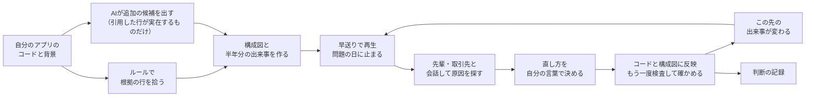
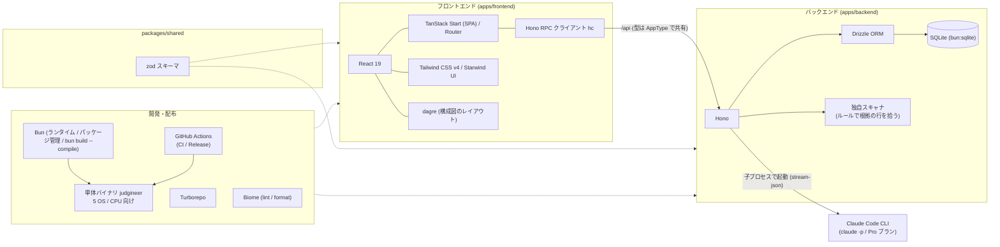

# ジャッジニア（Judgineer）


AIが当たり前の時代に、根拠を持って判断できるエンジニアになるための経験を積むプロダクト。

- デモ動画：[judgineer-demo.mp4](docs/videos/judgineer-demo.mp4)
- 説明スライド：[judgineer-slides.pdf](docs/judgineer-slides.pdf)

## すぐに試す
LinuxとmacOSで動きます。Windows（Git Bash）向けの実行ファイルも用意していますが、実機での動作はまだ確認できていません。AIの機能にはClaude Codeを使うので、先に`claude`コマンドをインストールしてログインしておいてください。

**1. インストールする**

ターミナルで次を実行します。

```sh
curl -fsSL https://raw.githubusercontent.com/jphacks/tka_2607/main/install.sh | bash
```

**2. ターミナルを開き直す**

インストールしたターミナルのままでは、まだ`judgineer`コマンドが使えません。新しいターミナルを開いてください。

**3. アプリを読み込む**

試したいアプリのフォルダに移動して、次を実行します。ブラウザでジャッジニアが開くので、取引先や契約などの背景を入れて登録します。

```sh
cd 試したいアプリのフォルダ
judgineer load
```

手元に試せるアプリがなければ、このリポジトリに入っているデモ用の題材で試せます。

```sh
git clone https://github.com/jphacks/tka_2607.git
cd tka_2607/samples/a_company_api
judgineer load
```

使い終わったら`judgineer stop`で止められます。

## 目次
- [製品概要](#製品概要)
  - [背景](#背景製品開発のきっかけ課題等)
  - [製品説明](#製品説明具体的な製品の説明)
  - [特長](#特長)
  - [ほかの方法との違い](#ほかの方法との違い)
  - [解決できること](#解決できること)
  - [今後の展望](#今後の展望)
  - [力を入れたこと](#力を入れたことこだわり等)
- [開発技術](#開発技術)

## 製品概要
**運用 × Tech**：自分のアプリの公開後を先に体験し、起きた問題を根拠を持って自分で判断して直す、運用の練習場所です。

### 背景(製品開発のきっかけ、課題等）
みなさん、最近AIになんでもかんでも丸投げしていませんか？

#### AIを使うことが悪いわけではない
調べもの、検証、コーディング。AIはいろいろな場面で役に立ちますし、使えば作業はどんどん速くなります。最近のエンジニアの知識が足りない、と言いたいわけでもありません。

ただ、今は大きな転換点にいます。開発はAIだけでも完結するようになり、何でもしてくれるAIに全部を任せるのが当たり前になりつつあります。JetBrainsが世界の開発者1万5千人以上に行った調査では、業務で書いたコードのうち、AIエージェントが丸ごと生成したものが平均で約47%を占め、AIの助けなしでコードを書いたことがない開発者も21%いました[^jetbrains]。

#### AIを使っているつもりで、AIに使われている
任せる量が増えると、自分で理解しないまま進めることが増えていきます。

- Anthropicが行ったランダム化比較試験では、AIを使って新しいライブラリを学んだグループは、手で書いたグループより理解度テストの点が17ポイント低くなりました。特に差が大きかったのはデバッグの問題です。同じAIを使っていても、コードを書くことを全部AIに任せた人は40%未満、仕組みについての質問だけをAIにして自分で書いた人は65%以上と、使い方で大きく分かれました[^anthropic]。
- MicrosoftとCarnegie Mellon大学の研究では、AIを信頼している人ほど、出てきた答えを自分で考えて確かめる手間をかけなくなる傾向が見られました[^msr]。

AIを道具として使うのではなく、AIが出したものをそのまま受け入れている状態です。

#### 開発なら影響を受けるのは自分たちだけ。運用ではそうはいかない
開発の段階なら、どれだけAIに任せて効率化しても、影響を受けるのは自分たちだけです。

しかし、公開したサービスの運用では話が変わります。お客さんの個人情報や取引先のデータを扱うので、問題が起きれば、被害を受ける範囲が自分以外まで広がってしまいます。

そして実際に、理解しないまま任せたものが、運用の問題になって返ってきています。AIが生成したコードのレビューを経験したエンジニアの約8割が、そのコードが原因のバグや障害の対応を経験しています。レビューで問題だと感じた点の1位は、提出した本人がコードの内容を説明できなかったこと（49.5%）でした[^kikkake]。自分で説明できないコードでは、問題が起きたときに、どう直すかを自分で決めることもできません。

だからこそ運用では、AIの答えをそのまま使うのではなく、自分で理解したうえで、責任を持って判断できる必要があります。ITエンジニア1,265人への調査でも、91.5%が、最終的に人が責任を持つべき仕事があると答えています[^ssl]。

#### 直し方に、正解はひとつではない
運用での判断が難しいのは、ひとつの正解があるわけではないからです。たとえば、次のような状況を考えます。

> A社は自社の顧客データを持っていて、そのデータを取引先のB社に提供しています。B社はそのデータを使って商売をしています。ある日、A社のシステムに、顧客データが外部に漏れるおそれのある欠陥（脆弱性）が見つかりました。

直し方の案として、次の2つがあるとします。

| | 欠陥 | B社への影響 | 作業の量 |
|---|---|---|---|
| 案1 | 直せる | データ提供が止まる | 少ない |
| 案2 | 直せる | 影響しない | 多く、時間がかかる |

AIはこうした修正案を出すことはできますが、A社にとってB社との取引がどれだけ大事かまでは知りません。どちらを選ぶかは、ログやコードから原因を確かめ、取引や契約といった事情も踏まえて、人が根拠を持って決める必要があります。

#### その判断を練習する場所がない
こうした判断の力は、本を読んだりAIに聞いたりするだけでは身につかず、実際に問題に向き合った経験がものを言います。ところが、運用での判断を練習できる場所はありません。本番のサービスで練習するわけにはいかないからです。

これまでは、ベテランが実際の障害対応の中で少しずつ教えてきました。しかし今は、その判断ができる人自体が限られています。大企業で障害対応をしているエンジニア316人への調査では、障害対応の判断や知識が3人以下に集中している職場が39.9%あり、中心の担当者が不在になると、68.0%が同じ水準で対応するのは難しい、または対応が遅れると答えています[^pagerduty]。

#### 課題をまとめると
| 誰の課題か | 課題 |
|---|---|
| これからのエンジニア | AIで作ることはできても、運用で問題が起きたときに、自分で理解して判断した経験がない |
| 企業 | 判断できる人が限られていて、新しく入った人に経験を積ませる余裕がない |

私たちは、これからのエンジニアに本当に求められるのは、根拠を持って意思決定できる力だと考えています。そこで、本番の前に、運用での判断を自分で経験できる場所を作りました。名前のジャッジニアは、判断（ジャッジ）できるエンジニアから付けています。

### 製品説明（具体的な製品の説明）
ジャッジニアは、自分が作ったアプリを公開したあとに何が起きるかを先に体験し、そこで起きた問題を、根拠を持って自分で判断して直すためのアプリです。

- **誰のためのものか**：AIを使ってアプリを作れるようになった学生や若手エンジニア。そして、そうしたエンジニアを迎え入れる企業。
- **何ができるか**：自分のアプリの、公開後の半年間を早送りで体験できます。起きた問題の原因を自分で探し、直し方を自分の言葉で決めると、その判断に応じてその後の運用が変わります。
- **どこが新しいか**：AIが答えを言わないこと、題材が自分のアプリのコードであること、判断に結果がついてくること、の3つです。

#### 使い方の流れ
**1. アプリを登録する**

自分が作ったアプリのコードと、そのアプリの背景を登録します。背景とは、取引先との関係、契約の内容、扱うデータの種類、チームの人数などのことです。


▶ [動画で見る（28秒）](docs/videos/01_register.mp4)

**2. 半年間を早送りする**

アプリを公開してからの半年間を、動画のシークバーのように早送りしながら再生します。どんな問題が起きるかは、その日になるまでわかりません。構成図では、影響が出ているところが色で示されます。


▶ [動画で見る（9秒）](docs/videos/02_play.mp4)

**3. 問題が起きて止まる**

ある日、問題が起きて再生が止まります。たとえば、取引先から「顧客データが外から見えている」と連絡が来たり、エラーの記録（ログ）が急に増えたりします。原因は登録した自分のアプリのコードの中にあり、問題に関係する行には印が付きます。


▶ [動画で見る（12秒）](docs/videos/03_incident.mp4)

**4. 会話しながら原因を探す**

AIが演じる先輩エンジニアや取引先の担当者と会話しながら、ログ、コード、システムの構成図を見て原因を探します。先輩は答えを言わず、問いかけてきます。途中で取引先から「いつ直りますか」と催促が入ることもあります。


▶ [動画で見る（53秒）](docs/videos/04_talk.mp4)

この例では、こちらが直し方を言っても、先輩は答え合わせをせず、構成図でこの処理を毎朝呼んでいるのは誰か、と問い返してきました。直したときに誰に影響するかまで考えさせるためです。

**5. 直し方を自分で決める**

原因がわかったら、どう直すかを自分の言葉で決めます。決めた内容は実際にコードに反映され、もう一度検査して、元の問題が消えたかどうかも確かめます。

 

▶ [動画で見る（10秒）](docs/videos/05_decide.mp4)

**6. その後の運用が変わる**

直し方によって、この先の半年間に起きることが変わります。その問題が起きなくなることもあれば、直し方が原因で別の日に新しい問題が起きることもあります。直さずに後回しにすることもできますが、重要な問題を後回しにすると、後でもっと大きな問題になって返ってくることもあります。


▶ [動画で見る（23秒）](docs/videos/06_after.mp4)　この例では、1件目の直し方がきっかけで、別の問題が新しく起きています。

**7. 判断を記録に残す**

最後に原因の答え合わせをして振り返ると、判断と理由、次へのメモが記録に残ります。次に別のアプリを登録したときには、似た場面で前回どう判断したかが表示されます。


#### しくみ


### 特長
#### 1. AIは答えを言わない
AIに聞けば答えが返ってくる、という使い方をあえてやめました。先輩役のAIは答えを言わずに問いかけ、ログやコードのどこを見ればよいかに気づかせます。原因の名前（たとえばSQLインジェクション）も先には言いません。いくつかの選択肢から正解を選ぶ形にもしていません。選ぶだけでは経験になりにくいためです。どうしても詰まったときは、ヒントだけをもらえます。

上で紹介した研究でも、AIに仕組みを質問しながら自分で書いた人は理解が残り、全部を任せた人は残りませんでした。ジャッジニアの先輩は、前者の使い方になるように話しかけてきます。

#### 2. 自分のアプリが題材になる
用意された練習問題ではなく、自分が作ったアプリのコードと背景をもとに、公開後に起きそうな問題を作ります。どの問題にも、それがコードのどのファイルの何行目から起きているかが必ず紐づいているので、原因を根拠から追うことができます。

#### 3. 判断に結果がついてくる
選んだ直し方によって、その後に起きる問題が、起きなくなる、小さくなる、大きくなる、新しく起きる、のいずれかに変わります。取引先や上司は、締め切りや契約、人手が足りないといった事情を持ち込んできます。現場と同じように、判断には結果と責任がついてきます。

#### 4. 失敗も経験として残る
本番のサービスではないので、間違った判断をしても誰にも迷惑はかかりません。うまくいかなかった判断も、なぜそうなったかと一緒に記録に残り、次のアプリを作るときに見返せます。失敗した経験が、そのまま次の判断の材料になります。

### ほかの方法との違い
| | 扱うもの | 答えは誰が出すか | 判断の結果 |
|---|---|---|---|
| ChatGPTなどの汎用AI | 質問したこと | AI | 返ってこない |
| コードの検査ツール・脆弱性診断 | 公開前のコード | ツール | 返ってこない |
| 研修や教材 | 用意された練習問題 | 教材に正解がある | 返ってこない |
| **ジャッジニア** | **自分のアプリの、公開後に起きる問題** | **自分** | **その後の運用が変わる** |

汎用のAIに、答えを言わずに問いかけて、と頼むことはできます。ただ、その場合は問題そのものを自分で用意する必要があり、判断したあとに何が起きるかも返ってきません。ジャッジニアは、自分のコードの実際の行から問題を作り、判断の結果をその後の半年間に反映させ、判断の記録を残します。

### 解決できること
エンジニアにとっては、次のことが解決できます。

* AIに任せきりにせず、根拠を持って判断する経験を、本番の前に何度でも積めます。失敗しても、それが次に活きる経験になります。
* AIが当たり前の世代のエンジニアが判断の経験を積むことで、AIのスピードと自分の根拠の両方を持ったエンジニアになれます。AIを使わないのではなく、AIを使いこなしたうえで、最後は自分で判断できる状態を目指します。
* 判断の経験を重ねることで、運用の問題を任せられる中堅のエンジニアへと成長していけます。
* 問題の原因を追ううちに、セキュリティ、インフラ、扱うデータの業界など、自分が向き合った分野が自分の強みになっていきます。

企業にとっては、次のことが解決できます。

* 新しく入ってきたエンジニアが、実際の障害に向き合う前に、自社の運用で起きうる問題への判断を経験しておけます。
* ベテランが付きっきりで教えなくても判断の経験を積めるので、育成の負担が下がります。空いたベテランの時間は開発や事業に、浮いたコストは若手の採用に回せます。
* 判断できる人が増えることで、障害対応の判断が一部の人に集中している状態を減らし、その人がいなくても対応できる体制に近づけます。
* 誰がどんな問題にどう判断したかが記録に残るので、育成の状況を確認しやすくなります。

#### 価値があるのは、直したコードより判断した経験
セキュリティの対策は、新しい攻撃が出るたびに追いかけ続けることになり、終わりがありません。そのため、私たちはジャッジニアを、穴のないアプリを作るための道具とは考えていません。攻撃の手口が変わっても、ログやコードから原因を確かめ、取引先や契約の事情まで踏まえて直し方を決める、という判断の進め方は変わりません。ジャッジニアで残るのは、直したコードそのものよりも、根拠を持って判断した経験です。その経験は、次にどんな問題が来ても使えます。

### 今後の展望
* 企業向けに、若手の育成を継続的に支えるサービスとして提供したいと考えています。コードが変わるたびに新しいシナリオを作る、新人が入るたびに使える、マネージャーが若手一人ひとりの成長を確認できる、といった形を考えています。
* 個人情報や医療情報など、業種や扱うデータごとの題材を増やし、自社のコードを使えない場合でも練習できるようにします。

### 力を入れたこと（こだわり等）
* **AIには答えを言わせない**：AIが出すのは事実と問いかけだけで、どう直すかは必ず人が決めます。おすすめの案も出しません。先輩の話し方は、良い問いかけと悪い問いかけ（答えを言ってしまう例）を並べて決めています（[prompts/chat.ts](./apps/backend/src/prompts/chat.ts)）。
* **実際のコードに原因がある問題だけを起こす**：起きる問題は、まずプログラムのルールでコードの該当行を拾い、その行を根拠に作っています（[scanner.ts](./apps/backend/src/scanner.ts)）。ルールで拾えない欠陥はAIに候補を出させますが、AIが引用した行が実際のコードにあるものだけを採用します（[extra.ts](./apps/backend/src/extra.ts)）。ありえない問題に振り回されることがありません。
* **直ったかどうかをコードで確かめる**：修正を反映したあと、コードをもう一度検査して、元の問題が消えたか、残っているか、新しく生まれたかを判定しています（[verify.ts](./apps/backend/src/verify.ts)）。直したつもりで直っていない、という場面もそのまま結果に出ます。
* **選択肢ではなく会話で進める**：先輩は答えを言わず、関係者は判断を急かしてくるので、実際の現場に近い状況で判断できます。
* **判断で何が変わったかを見せる**：修正前後のコードの違い、システム構成の変化、この先の半年間への影響まで表示します（[fix.ts](./apps/backend/src/fix.ts)、[FixView.tsx](./apps/frontend/src/components/FixView.tsx)）。
* **元のコードは変えない**：修正は登録したアプリのコピーにだけ入れていて、元のファイルは変えません。
* **すぐに試せる形で配る**：コマンド1行でインストールでき、`judgineer load`で今いるフォルダのアプリをすぐ登録できるようにしました。

[^jetbrains]: JetBrains「Developer Ecosystem Survey 2026」の分析（2026年8月公表、世界の開発者1万5千人以上）。[＠IT の記事](https://atmarkit.itmedia.co.jp/ait/articles/2609/28/news045.html)
[^anthropic]: Anthropic「How AI assistance impacts the formation of coding skills」（2026年1月、エンジニア52人のランダム化比較試験）。使い方ごとの比較は人数が少なく、因果関係までは示していないと研究自体が注記しています。[記事](https://www.anthropic.com/research/AI-assistance-coding-skills)
[^msr]: Microsoft Research・Carnegie Mellon大学「The Impact of Generative AI on Critical Thinking」（CHI 2025、知識労働者319人）。[The Register の記事](https://www.theregister.com/2025/02/11/microsoft_study_ai_critical_thinking/)
[^kikkake]: キッカケクリエイション調査（2026年2月、コードレビューを担当するITエンジニア322人。数字はAI生成コードのレビュー経験者277人の回答）。[＠IT の記事](https://atmarkit.itmedia.co.jp/ait/articles/2606/16/news041.html)
[^ssl]: スーパーソフトウエア調査（2026年8月、ITエンジニア1,265人）。[プレスリリース](https://prtimes.jp/main/html/rd/p/000000038.000004742.html)
[^pagerduty]: PagerDuty調査（2026年8月、従業員1,000人以上の企業で障害対応をしているエンジニア316人）。[プレスリリース](https://prtimes.jp/main/html/rd/p/000000035.000101675.html)

## 開発技術
### 活用した技術
#### API・データ
* Claude Code（`claude` コマンド）: 構成図・利用シナリオ・出来事の台本・修正案の生成に使う。API キーは使わず、手元のログイン（Pro プラン）で動かす
* SQLite: 解析結果や会話の履歴をローカルに保存する

#### フレームワーク・ライブラリ・モジュール
* フロントエンド: TanStack Start（SPA モード）/ React 19 / Tailwind CSS v4 / Starwind UI
* バックエンド: Hono / Drizzle ORM（SQLite）
* 共通: zod（フロント・バックで共有するスキーマ）/ Bun / Turborepo / Biome

#### 技術スタック図


### 独自技術
#### ハッカソンで開発した独自機能・技術
* 独自で開発したものの内容をこちらに記載してください
* 特に力を入れた部分をファイルリンク、またはcommit_idを記載してください。

## Install
```sh
curl -fsSL https://raw.githubusercontent.com/jphacks/tka_2607/main/install.sh | bash
```
Linux / macOS / Windows（Git Bash から実行）に対応。`~/.judgineer` に置かれ、`judgineer` コマンドが使えるようになる。AI の機能には Claude Code（`claude`）が必要。

### コマンド
```sh
bun install          # 依存関係のインストール
bun run dev          # frontend と backend を同時に起動
bun run build        # ビルド
bun run typecheck    # 型チェック
bun run test         # テスト
bun run check        # lint と format の検査（Biome）
bun run format       # lint と format の自動修正（Biome）
```

## 開発者向けセットアップ
### 構成
```
apps/frontend    TanStack Start (SPA) + React + Starwind UI   http://localhost:3000
apps/backend     Hono + Drizzle (bun:sqlite)                  http://127.0.0.1:3001
packages/shared  zod スキーマ（フロント・バック共有）
```

### 必要なもの
* [Bun](https://bun.com/) 1.4 以上（Node.js / pnpm は不要）

* 開発時、フロントの `/api` はバックエンドへプロキシされる。
* バックエンドの環境変数は `apps/backend/.env.example` を参照（`PORT`、`DATABASE_URL`）。
* 開発時は、起動時に環境変数 `TARGET_DIR`（既定は `samples/a_company_api`）を検査対象の一覧へ足す。デモ用の題材が `samples/` にあるので、そのまま `bun run dev` すると試せる。
* 修正は検査対象のコピー（`data/projects/<id>/current`）にだけ入り、元のファイルは変わらない。
* VS Code では拡張機能「Biome」（`biomejs.biome`）を入れると、保存時に lint と format が自動で走る。

### judgineer コマンド（単体バイナリ）
`bun run build && bun run build:binary` で `dist-bin/` に OS ごとの単体バイナリを作れる。

```sh
judgineer help        # コマンドの一覧
judgineer load        # 今いるフォルダをプロジェクトの一覧に加えて、ブラウザで開く（ディレクトリも指定できる）
judgineer start       # サーバーだけを裏で起動する
judgineer stop        # サーバーを止める
judgineer update      # 最新のリリースを確認し、新しい版があれば置き換える（--check は確認だけ）
judgineer uninstall   # 削除する（--purge で解析データも消す）
```

リリースは `.github/workflows/release.yml` が、公開時に 5 つの OS / CPU 向けの単体バイナリと `SHA256SUMS` を添付する。ビルド中でバイナリが無いときは、`install.sh` が最新から 5 件前までさかのぼって探す。

詳しい開発ルールは [AGENTS.md](./AGENTS.md) を参照。
